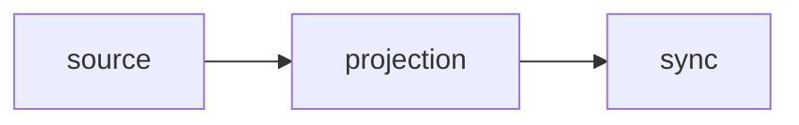

# Architecture

Phora is organized around three capability modules — *source*, *projection*, and
*sync*. `cli` sits at the top of the stack and drives them; `lock`, `paths`,
`digest`, `diagnostic`, `mount`, and `error` are shared support modules. `config` is
parsed at the edge and consumed at the sync boundary — after PR3 it reaches
projection only as converted spec values, never as a raw DTO. The physical
module layout matches the real data flow: content is obtained, a desired target
structure is calculated, and machine state is reconciled to match it.

## The source → projection → sync decision

The crate's capability chain is **source → projection → sync**, and this is the
architectural decision that governs where every responsibility lives.

- *source* obtains immutable content. Given a Git, HTTP, or worktree origin it
  resolves a snapshot and exposes an inventory of entries and their bytes. It
  performs source and cache I/O only.
- *projection* is a pure, I/O-free calculation. It maps source values and
  inventories to the desired target structure — a `Projection` of projected
  artifacts and leaves — and performs no I/O of any kind.
- *sync* is the sole owner of target-side machine state. It observes what is on
  disk, reconciles it against the projection, stages and applies changes,
  journals for recovery, and owns state records, ejections, hooks, and locking.

Link-mode artifacts are the exception to snapshot immutability: link artifacts
materialize as symlinks into the live worktree, while `SnapshotId::Worktree`
freezes inventory and copy-mode reads.

Data flows one way: source feeds projection, projection feeds sync. Imports run
the opposite way: a downstream capability may import an upstream one — sync
imports projection and source, projection imports source's pure value types —
but an upstream capability never imports a downstream one.

## Module placement rule

Each responsibility is placed by which capability owns it. A change belongs to
the module whose sentence below it satisfies:

- source obtains immutable content — it reads and fetches origin bytes into a
  snapshot, and never mutates them.
- projection is a pure, I/O-free calculation of the desired target structure — it
  computes a deterministic `Projection` from values and inventories alone.
- sync is the sole owner of the target machine state — it owns observation,
  reconciliation, staging, application, recovery, state records, and locking.

If a piece of work needs the filesystem or the network to decide the target
shape, it does not belong in projection. If it inspects or mutates the machine,
it belongs in sync. If it acquires origin content, it belongs in source.
Projection owns `TargetName` and `ArtifactName`; source owns `SourceName` and
`Commit`. Projection may import only the pure source values it consumes.

## Invariants

The placement rule is enforced by a small `rg` arch-lint (`scripts/arch-check.sh`,
in CI from PR1) plus module privacy. The two structural invariants below are the
load-bearing boundaries; the remaining invariants are summarized after them, with
design.md holding the authoritative specification.

### INV-1 — projection purity

Projection performs no I/O; it is a pure, I/O-free calculation of the desired
target structure. The projection module imports no `config` DTO, no source I/O
(`SourceStore`, `SnapshotId`, resolve, or fetch), and none of `sync`, `cli`,
`std::fs`, `std::process`, network libraries, `gix`, `serde`, or `chrono`. It may
import only the pure source value types (`SourcePath`, `SourceInventory`,
`SourceEntryMeta`, `SourceEntryKind`, `SourceName`, `Commit`) it consumes, the
pure external crates it genuinely needs, and its own modules. `TargetName` and
`ArtifactName` are projection-owned. A positive allowlist lint rejects any other
import.

### INV-2 — source boundary

Source never imports projection, target, manifest, or registry types. It also
does not reference `sync`, `sync::state`, target paths, or template deployment
policy. The boundary is enforced as three independently dated clauses tied to
expiry tasks: target-type removal (PR5), staging and manifest removal (PR6), and
source-transitive extraction (PR12). `digest_snapshot` takes explicit leaves, not
an `OfferSelection`, so source never depends on a projection type to compute a
digest.

### INV-3 through INV-10

design.md is the authoritative specification for these invariants; each line
below is the durable one-sentence record.

- INV-3 — only `sync` and `cli` perform target-side I/O; source performs
  source/cache I/O; projection performs none. `src/mount.rs` is the one
  permanent platform I/O owner outside them: it sits below source and sync and
  only reads, answering where a path lies relative to an anchor directory's
  mount and whether its absence is proven.
- INV-4 — serialized formats (lock, registry, journal, config, cache/mirror
  layout) stay byte-identical throughout; no schema or version bump.
- INV-5 — artifact, source, variable, and file digests, modes, mtimes,
  manifests, symlink rejection, and template errors are unchanged when export
  moves out of source.
- INV-6 — URL sources resolve to the same Git snapshot representation as Git
  sources with unchanged synthetic commit IDs; worktree snapshots freeze source
  content so inventory→read is race-free.
- INV-7 — previewed projected artifacts equal the artifacts sync manages equal
  the artifact keys prune protects.
- INV-8 — reconciliation is a pure function of `(Projection,
  ObservedProjectState, policy)`; no filesystem access after
  `ObservedProjectState` is constructed.
- INV-9 — CLI human-readable output and exit codes are unchanged; only `main`
  calls `std::process::exit`.
- INV-10 — git blame is preserved across file relocations, via `git mv` before
  edits and whole-file moves with `git log --follow` spot-checks.

## State lifecycle

Every state dir under the default state root and under every registered state
root is live, dropped once provably dead, or reported until `phora gc` resolves
it. Liveness is a function of stored data alone: phora never scans the
filesystem for projects and applies no age cutoff. The lifecycle lives in
`sync::state::lifecycle`, beside the state records and locking it extends.

- Recorded root. A project's own locked run writes `project.toml` into its
  state dir with `atomic_write`: the canonical root, whether that root sat on
  the state dir's mount, and the state-dir path as the run saw it. Paths that
  are not valid UTF-8 are stored as hex bytes. A meta whose root does not hash
  to the dir's `ProjectId` is invalid. Locks taken on other projects' dirs never
  write a meta.
- State-root index. A locked run whose state root is not the default registers
  that root in `state-roots.toml` under the default state root, read and
  written under `state-roots.lock`. The same run marks every other copy of its
  id in the default and registered roots `superseded_by` its current root.
- Proof of deletion. `mount::locate` walks the recorded root with
  `symlink_metadata` and yields `Present`, `Deleted` with a proof, or
  `Unproven`. A proof needs the root `NotFound`, recorded on the state dir's
  mount, an unchanged state-dir path, and its nearest existing ancestor on that
  mount now and unencrypted, with no symlinked component on the way.
- Classification. One probe gathers the filesystem facts; `classify` is a pure,
  total function of the probe and yields one of four classes, each carrying a
  reason: Keep (`live`), Drop (`empty`, `gone`), Release (`retired`,
  `stranded`), Forget (`unrooted`, `abandoned`, `unreachable`). Records are read
  only when the root is proven deleted.
- Sweep. Every locked, non-frozen run of the sync pipeline whose status is not
  failed sweeps in the deploy tail of `sync_core`, after deploy, hook and build
  failures are known and before the summary. The sweep input rides on
  `SyncRequest` and `SyncRunInput`; the lockless frozen path, a run aborted
  before the deploy phase, and the nested build run carry none. The sweep drops
  Drop-class dirs, releases the dangling links of a deleted root, and reports
  every other reason in one `SyncWarning` that names `phora gc`. A sweep error is
  a warning and never changes the exit code.
- Own-dir removal. The holder of a state dir's `state.lock` removes the dir
  before releasing the lock when it holds no records, target meta or pending
  journal. A run's own dir is therefore never left empty, and the sweep skips it.
- Drop path. Each drop locks the dir with zero timeout, re-probes and proceeds
  only if the reason is unchanged, releases links through
  `confine_removal_destination`, renames the dir to
  `<state root>/trash/<ProjectId>.<suffix>`, and deletes it, all under the lock.
  A trash entry left by a failed delete or a crash is deleted by the next sweep
  or `gc`; entries whose name is not a phora trash entry are never touched.
- `phora gc`. `src/cli/gc.rs` drives `plan_gc` and `apply_gc`: it lists every
  non-live dir with its evidence and planned action, applies Drop-class drops
  and link releases without confirmation, and with `--eject` and a confirmation
  ejects the history worktrees of Release-class dirs into standalone clones and
  drops every non-live dir. It then prunes the content store, counting the
  `projects/` of every enumerable state root as GC roots. It deletes no deployed
  file beyond the released links.

## DoD → task → test traceability

Each Definition-of-Done item from refactor-plan §16 maps to the task that
delivers it and a test that pins the surface. Where an item's dedicated pinning
test lands in a later PR, the cited file is the existing on-disk test that
currently covers that surface; task T031 re-verifies and finalizes this table at
the end of the migration.

| DoD | Requirement (plan §16) | Task | Pinning test |
| --- | --- | --- | --- |
| 1 | source, projection, and sync are the three capability modules | T031 | tests/final_architecture.rs |
| 2 | no top-level backend, deploy, store, or kernel | T030 | tests/final_architecture.rs |
| 3 | projection performs no I/O | T007 | tests/arch_check.rs |
| 4 | projection imports no config DTOs or source traits | T009 | tests/arch_check.rs |
| 5 | source imports no projection, sync-state, target-path, template-policy, or manifest types | T029 | tests/arch_check.rs |
| 6 | every Git, HTTP, and worktree source resolves to a snapshot abstraction | T012 | tests/source_snapshot_contract.rs; tests/source_snapshot_gate.rs; tests/source_compat_contract.rs |
| 7 | SourceBackend and unsupported default methods are gone | T030 | tests/source_layout.rs |
| 8 | target-specific rendering and manifest generation live under sync | T016 | tests/compat_staging.rs; tests/stage_deletion_gate.rs |
| 9 | desired state is represented by a Projection | T020 | tests/projection_contract.rs; tests/projection_contract_gate.rs |
| 10 | current machine state is represented by ObservedProjectState | T017 | tests/reconcile_matrix_contract.rs; tests/reconcile_matrix_gate.rs |
| 11 | pending work is represented by a ChangeSet | T018 | tests/reconcile_matrix_contract.rs; tests/reconcile_matrix_gate.rs |
| 12 | preview, sync, and prune share the same projected artifact identities | T021 | tests/compat_serialized.rs; tests/orchestration_gate.rs |
| 13 | drift classification after inspection is pure | T019 | tests/reconcile_matrix_contract.rs; tests/reconcile_matrix_gate.rs |
| 14 | state records, ejections, hooks, and locking live under sync::state | T025 | tests/state_store_contract.rs; tests/state_store_gate.rs |
| 15 | journaling and recovery live under sync | T022 | tests/compat_recovery.rs; tests/deploy_relocation_gate.rs |
| 16 | the CLI constructs dependencies, renders reports, and maps exit codes, but does not implement sync behavior | T027 | tests/sync_request_contract.rs; tests/compat_cli.rs |
| 17 | existing config, lock, registry, journal, digest, and CLI behavior remains compatible | T002 / T004 / T024 / T028 | tests/compat_serialized.rs; tests/compat_recovery.rs; tests/compat_cli.rs |
| 18 | architecture checks prevent forbidden dependencies | T031 | tests/arch_check.rs |
| 19 | crate-level documentation describes the feature-oriented architecture | T031 | tests/final_architecture.rs |
| 20 | `cargo test`, `cargo clippy`, `cargo fmt --check`, and the integration suites pass, including all compatibility fixtures and unit tests | T031 | tests/compat_serialized.rs; tests/compat_staging.rs; tests/compat_recovery.rs; tests/compat_cli.rs |

## SourceBackend caller-migration table

This table is the historical completion record for the interface removed by
T030. Every former method is gone; live sync, CLI, transitive, test, and
benchmark flows use the final four-operation `SourceStore` capability and the
free digest operation.

| Method | Disposition | Final successor | Remaining consumers |
| --- | --- | --- | --- |
| `fetch` | removed | typed `SourceStore::resolve` with `ResolvePolicy::Refresh` | none |
| `mirror_ready` | removed | typed cached resolution with `ResolvePolicy::CachedOnly` | none |
| `read_file_at` | removed | `SourceStore::read` | none |
| `list_source_leaves` | removed | `SourceStore::inventory` | none |
| `list_tree_at` | removed | `SourceStore::list_directory` | none |
| `resolve` | removed | `SourceStore::resolve` returning `ResolvedSource` | none |
| `commit_time` | removed | `ResolvedSource::authored_at` | none |
| `export_artifact` | removed | `stage_artifact` over `SourceStore::read` (T016) | none |
| `compute_digest` | removed | `source::digest_snapshot` | none |
